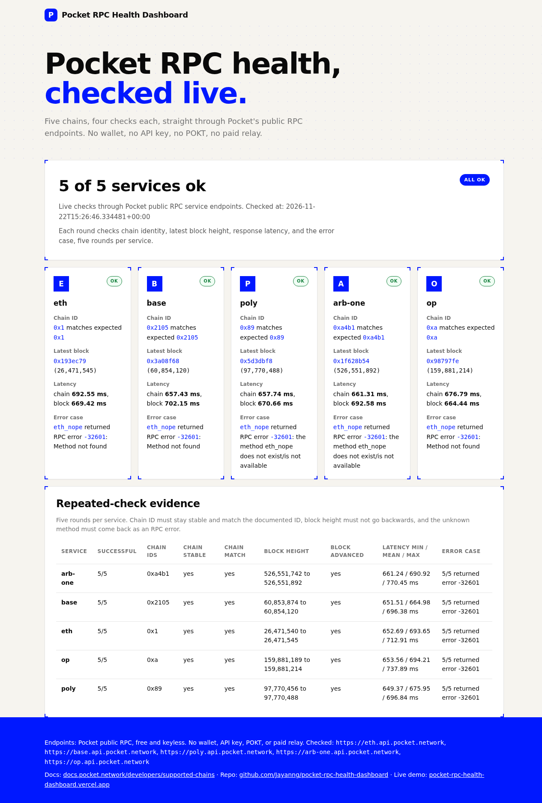

# Pocket RPC Health Dashboard

A small reproducible application that checks Pocket Network public RPC
services and turns the results into a practical health and reliability
report. No wallet, API key, POKT, staking, or paid relay is needed:
it uses the Foundation's free, keyless public RPC.

## Demo video

[](demo/pocket-demo-1min.mp4)

[Watch the 1-minute demo video (62 seconds)](demo/pocket-demo-1min.mp4)

## What it checks

For every service, each round runs four checks:

1. **Chain identity:** `eth_chainId`, compared with the documented
   chain ID for that network.
2. **Block height:** `eth_blockNumber`, read every round so repeated
   runs show the height advancing.
3. **Latency:** response time of the chain and block calls.
4. **Error handling:** an unknown method (`eth_nope`) is sent on
   purpose. A healthy endpoint answers with RPC error `-32601`; the
   code and message are recorded as the failure case.

Repeated runs aggregate into evidence: successful vs failed checks,
chain ID stability and match, block height range and advancement,
latency min/mean/max, and the error-case outcome.

## Pocket services

Endpoints are the public RPC documented at
https://docs.pocket.network/developers/supported-chains/
(`https://{slug}.api.pocket.network`, free and keyless, no account):

| Service | Endpoint | Expected chain ID |
| --- | --- | --- |
| eth | https://eth.api.pocket.network | `0x1` |
| base | https://base.api.pocket.network | `0x2105` |
| poly | https://poly.api.pocket.network | `0x89` |
| arb-one | https://arb-one.api.pocket.network | `0xa4b1` |
| op | https://op.api.pocket.network | `0xa` |

## Run

One run produces both the JSON evidence and the HTML dashboard from
the same checks, so the two artifacts always match. Run them together,
never as two separate runs:

```bash
python3 src/main.py --runs 5 --pause 2 --json --html report.html > evidence.json
```

- `--runs 5`: five rounds of checks per service.
- `--pause 2`: two seconds between rounds, so block heights have
  time to advance.
- `--json`: print the JSON report (redirected to `evidence.json`).
- `--html report.html`: write the dashboard from the same run.

The HTML report is a local dashboard. The JSON report is suitable for
saving as test evidence. The `screenshots/report.png` file is a
browser-captured image of the generated dashboard.

## Live demo

The generated dashboard from the latest fresh run, deployed as a
static site:

https://pocket-rpc-health.vercel.app

A 1-minute demo video explaining the dashboard is in the repo at
`demo/pocket-demo-1min.mp4` (62 seconds, H.264 1280x800), with the
script at `demo/script.md`.

## Tests

```bash
python3 -m unittest discover -s tests -v
```

Tests are offline unit tests with a mocked transport, so they run
without network access. Live behaviour is verified separately by a
fresh run against the real Pocket endpoints.

## Quest evidence plan

- Demo: generated `report.html` showing live Pocket checks, plus the
  live demo URL above.
- Documentation/repository: this repository and its run instructions.
- Service identifiers: `eth`, `base`, `poly`, `arb-one`, and `op`.
- Test outcomes: JSON report with status, chain ID, block height,
  latency, and the recorded RPC error case.
